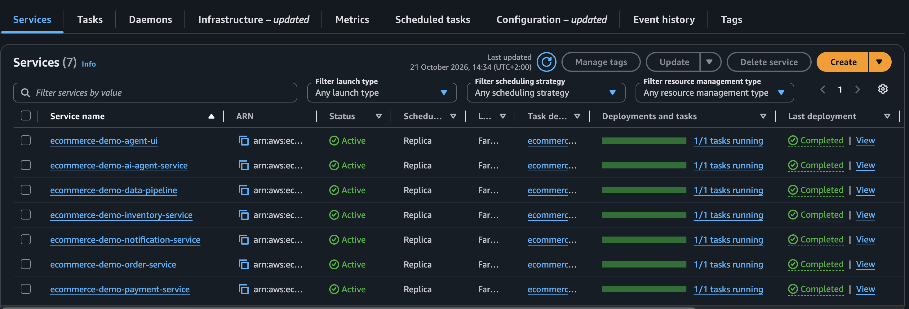
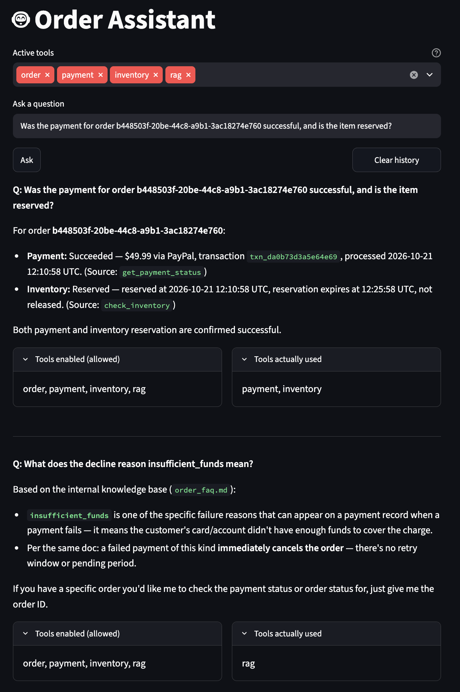
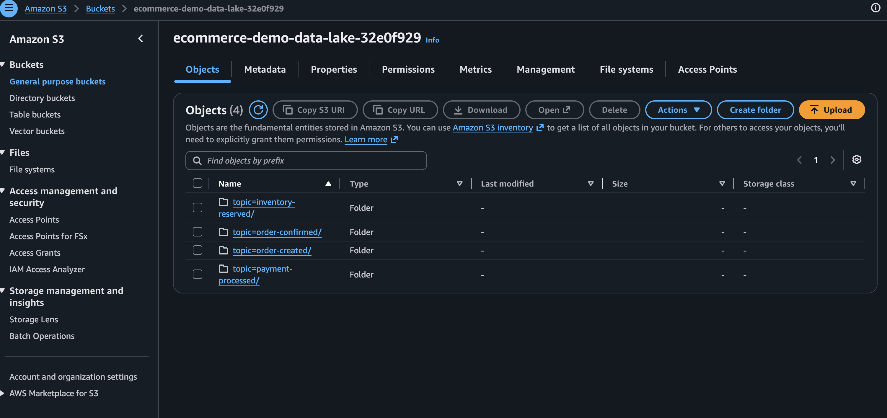
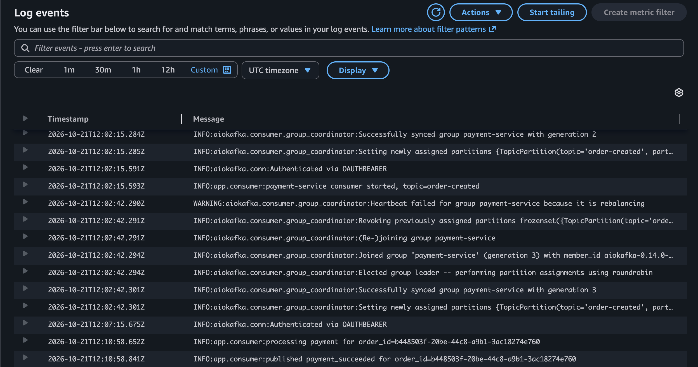

# Terraform: the AWS deployment

> **Status: deployed end to end and destroyed again (21 October 2026).**
> All seven services ran on ECS against MSK, RDS and S3; an order placed
> through the load balancer was paid, reserved, confirmed and archived to the
> data lake, and the AI agent answered from live data and from the RAG
> knowledge base. The first deploy found four bugs that never show locally;
> they are listed under [What the first deploy found](#what-the-first-deploy-found).
> The whole session, from empty account to verified stack, cost about $1.

Everything here is billed by the hour while it exists. **The stack is meant to
be created for a demo session and destroyed straight after.**

## What it creates

| Layer | Resources | File |
|---|---|---|
| Network | VPC across two AZs, public subnets (ALB only), private subnets (everything else), one NAT gateway | `vpc.tf`, `security_groups.tf` |
| Data | RDS PostgreSQL 16 (`db.t3.micro`, single-AZ, 20 GB gp3) holding four databases; S3 data lake | `rds.tf`, `s3.tf` |
| Streaming | MSK provisioned, Kafka 3.9 (ZooKeeper mode), two `kafka.t3.small` brokers, IAM authentication | `msk.tf` |
| Compute | ECS cluster on Fargate (ARM64), one service per microservice, Service Connect for internal DNS | `ecs.tf`, `locals.tf` |
| Edge | Internet-facing Application Load Balancer, path-based routing | `alb.tf` |
| Images | One ECR repository per service, with a lifecycle policy | `ecr.tf` |
| Secrets | Secrets Manager: DB master password, one connection string per service, the Anthropic API key | `secrets.tf`, `ecs.tf` |
| Access | Task and execution roles; a GitHub Actions OIDC role for deploys | `iam.tf`, `oidc.tf` |

Per-service settings (CPU, memory, database, environment variable names, ALB
paths) live in one table in `locals.tf`, and every resource that is per
service is generated from it.

## Cost

Prices are on-demand, eu-south-2, USD, read from the AWS Price List API by
[`scripts/price_check.py`](scripts/price_check.py) (October 2026). Rerun it
before relying on them.

| Resource | Sizing | Unit price | Per hour |
|---|---|---|---|
| Fargate (ARM64) | 2 vCPU, 4 GB across 7 tasks | $0.03724 / vCPU-h, $0.00409 / GB-h | $0.091 |
| MSK brokers | 2 × `kafka.t3.small` | $0.0499 / broker-h | $0.100 |
| MSK storage | 2 × 20 GB | $0.11 / GB-month | $0.006 |
| RDS PostgreSQL | `db.t3.micro` single-AZ, 20 GB gp3 | $0.02 / h, $0.127 / GB-month | $0.023 |
| NAT gateway | 1 | $0.048 / h, plus $0.048 / GB processed | $0.048 |
| Application Load Balancer | 1, up to ~1 LCU at demo traffic | $0.0252 / h, $0.008 / LCU-h | ≤ $0.033 |
| Public IPv4 | 3 (ALB in two AZs, NAT elastic IP) | $0.005 / address-h | $0.015 |
| Secrets Manager | 6 secrets | $0.40 / secret-month, pro rata | $0.003 |
| ECR | ~3 GB of images | $0.10 / GB-month | < $0.001 |
| **Total** | | | **≈ $0.32 / hour** |

| Left running for | Cost |
|---|---|
| A 2-hour demo | ≈ $0.64 |
| A day | ≈ $7.70 |
| A month, forgotten | **≈ $234** |

Not included: CloudWatch Logs (7-day retention, negligible at demo volume),
NAT and inter-AZ data transfer (cents at demo volume), and Anthropic API
usage, which is billed by Anthropic.

Where the money goes: MSK ≈ 33%, Fargate ≈ 28%, NAT gateway ≈ 15%. All three
bill every hour whether or not any traffic flows, which is why the stack is
destroyed between sessions.

## Before the first apply

0. **Use a paid AWS plan.** Accounts on AWS's free plan cannot use MSK: every
   MSK call, starting with `CreateConfiguration`, fails with
   `SubscriptionRequiredException`. Upgrading the account lifts it. Set a
   budget alert (Billing → Budgets) at the same time.
1. **Enable eu-south-2.** Europe (Spain) is an opt-in region: enable it under
   *Account → AWS Regions* before applying, or every call fails.
2. **Tools:** Terraform ≥ 1.9, the AWS CLI, Docker, `jq`, `psql`.
3. **Variables:**
   ```bash
   cp terraform/terraform.tfvars.example terraform/terraform.tfvars
   ```
   Set `github_repo` (required, `owner/name`) and, for the database
   bootstrap, `admin_ip_cidr` to your own IP (`x.x.x.x/32`). `terraform.tfvars`
   is gitignored.

## Spin up

Run everything from the repo root. Allow about an hour; MSK alone takes 20 to
40 minutes to create.

```bash
terraform -chdir=terraform init
terraform -chdir=terraform plan  -out=demo.tfplan
terraform -chdir=terraform apply demo.tfplan
```

Then, in this order:

1. **Push the images.** ECS services exist after the apply but cannot start
   until their images are in ECR:
   ```bash
   ./terraform/scripts/push_images.sh
   ```
   Images are built for `linux/arm64`, native on Apple Silicon.
2. **Set the Anthropic key** outside Terraform, so it never lands in
   Terraform state. `read -rs` keeps it off the screen and out of shell
   history. Until it is set, the agent's task fails to launch, loudly:
   ```bash
   read -rs ANTHROPIC_KEY; echo
   aws secretsmanager put-secret-value --region eu-south-2 \
     --secret-id "$(terraform -chdir=terraform output -raw anthropic_secret_name)" \
     --secret-string "$ANTHROPIC_KEY"
   unset ANTHROPIC_KEY
   ```
3. **Create the databases and run the migrations.** RDS creates one database
   at launch and has no init-script hook; this is the replacement:
   ```bash
   ./terraform/scripts/bootstrap_databases.sh
   ```
4. **Create the Kafka topics, then load the RAG documents.** The brokers and
   the database are private, so both run as one-off ECS tasks inside the VPC:
   ```bash
   CLUSTER=$(terraform -chdir=terraform output -raw ecs_cluster_name)
   SUBNETS=$(terraform -chdir=terraform output -json private_subnet_ids | jq -r 'join(",")')
   SG=$(aws ec2 describe-security-groups --region eu-south-2 \
     --filters Name=group-name,Values=ecommerce-demo-ecs-tasks-sg --query 'SecurityGroups[0].GroupId' --output text)
   run_once() {  # $1 = service, $2 = command as a JSON array
     local task
     task=$(aws ecs run-task --region eu-south-2 --cluster "$CLUSTER" \
       --task-definition "ecommerce-demo-$1" --launch-type FARGATE \
       --network-configuration "awsvpcConfiguration={subnets=[$SUBNETS],securityGroups=[$SG],assignPublicIp=DISABLED}" \
       --overrides "{\"containerOverrides\":[{\"name\":\"$1\",\"command\":$2}]}" \
       --query 'tasks[0].taskArn' --output text)
     aws ecs wait tasks-stopped --region eu-south-2 --cluster "$CLUSTER" --tasks "$task"
     aws ecs describe-tasks --region eu-south-2 --cluster "$CLUSTER" --tasks "$task" \
       --query 'tasks[0].containers[0].exitCode'    # expect 0
   }
   run_once order-service    '["python","-m","app.create_topics"]'
   run_once ai-agent-service '["python","-m","app.rag","ingest","./docs"]'
   ```
5. **Restart the services** so they pick up the images, secret and topics:
   ```bash
   for s in $(aws ecs list-services --region eu-south-2 --cluster "$CLUSTER" --query 'serviceArns[]' --output text); do
     aws ecs update-service --region eu-south-2 --cluster "$CLUSTER" --service "$s" --force-new-deployment >/dev/null
   done
   ```
   After 3 to 5 minutes every service should show one running task.
6. **Verify through the load balancer.** The ALB routes `/orders` to
   order-service and everything else to the agent UI:
   ```bash
   ALB=$(terraform -chdir=terraform output -raw alb_url)
   curl -s -X POST "$ALB/orders" -H "Content-Type: application/json" \
     -d '{"customer_id": "11111111-1111-1111-1111-111111111111", "total_amount": "49.99"}'
   curl -s "$ALB/orders/<id>"      # confirmed or cancelled within ~15 s
   aws s3 ls "s3://$(terraform -chdir=terraform output -raw data_lake_bucket)/" --recursive
   ```
   Then open `$ALB` in a browser and ask the agent about the order, and
   about a decline reason such as `insufficient_funds` (answered from the
   RAG documents).

## Verified on AWS

| Check | Result |
|---|---|
| All services on ECS | 7 of 7 running, each authenticated to MSK through IAM (`Authenticated via OAUTHBEARER`) |
| Order through the ALB | `confirmed`; payment, inventory and notification each logged it |
| Data lake | One file per topic under `topic=<name>/date=<day>/` in S3 |
| AI agent, live data | Answered the order's status, payment and reservation, using exactly the order, payment and inventory tools |
| AI agent, RAG | Before ingestion: reported the knowledge base as unavailable and labelled its fallback as inferred. After: answered from `order_faq.md` using only the rag tool |






## What the first deploy found

Each of these passed every local test, because locally Kafka runs without TLS,
the data lake writes to disk and every service's database URL comes from its
own `.env`.

| Problem | Symptom on AWS | Fix |
|---|---|---|
| The Kafka client was given no TLS context | Every producer and consumer failed at start-up: `ssl_context is mandatory` | `kafka_auth.py` passes `ssl_context=create_ssl_context()` for `SASL_SSL`; reproduced and verified locally without MSK |
| `get_sink()` returned the `S3Sink` class instead of an instance | The data pipeline retried a failing flush every second and wrote nothing | `return S3Sink()`, plus `tests/test_sink.py`, which fails on the old code. No events were lost: offsets were never committed, so Kafka redelivered them to the fixed task |
| Every database URL used the SQLAlchemy scheme `postgresql+asyncpg://` | The agent, which uses plain psycopg, could not connect to its database, so RAG was unavailable | A per-service `db_url_scheme` in `locals.tf` (`postgresql` for the agent). Fixed by hand in Secrets Manager during the session; the Terraform fix is validated but not yet exercised by a deploy |
| The first RAG question loads the embedding model | The agent UI got `504 Gateway Timeout` from Service Connect's 15-second request limit; the second question was fast | Not fixed yet: load the model at start-up, and raise Service Connect's `per_request_timeout_seconds` for the agent |

Two AWS constraints also changed the plan: MSK no longer offers Kafka 3.7 on
standard brokers, and KRaft mode requires `m5`, `m7g` or Express brokers. The
stack therefore runs Kafka 3.9 in ZooKeeper mode on `kafka.t3.small`, while
the local Docker setup keeps KRaft. The services cannot tell the difference.

## Tear down

```bash
terraform -chdir=terraform destroy
terraform -chdir=terraform state list | wc -l    # expect 0
```

A count of 0 means Terraform is tracking nothing. Anything created by hand
(for example the one-off topic task) stops by itself; check the ECS and MSK
consoles if in doubt.

## Design decisions

**Kafka 3.9 in ZooKeeper mode on `kafka.t3.small`.** KRaft on MSK needs
`kafka.m5.large` or larger brokers, several times the price of two
`kafka.t3.small` brokers. ZooKeeper mode is managed and invisible to the
clients, so the cheaper brokers cost nothing in behaviour.

**MSK provisioned, not Serverless.** In eu-south-2 MSK Serverless costs
$0.8625 per cluster-hour plus $0.001725 per partition-hour (15 partitions:
five topics × three) plus data in and out. Two `kafka.t3.small` brokers with
their storage cost about $0.106 per hour. For a cluster that idles between
demos that is roughly eight times the cost for no functional gain. Serverless
would win for spiky production traffic where sizing brokers is the harder
problem.

**One RDS instance, four databases.** Each service owns its database, as it
does locally, but they share one `db.t3.micro`. That keeps the
database-per-service boundary (no cross-database queries, separate
credentials and connection strings) at a quarter of the cost of four
instances. The trade-off is a shared failure domain and shared capacity: one
noisy service can slow the others, and they are backed up and upgraded
together. In production each service would get its own instance, or at least
the critical ones would.

**ARM64 Fargate.** About 20% cheaper than x86 at these prices ($0.091 versus
$0.114 per hour for the same tasks), and native to an Apple Silicon build
machine, so the images need no emulation.

**One NAT gateway.** Private tasks reach the internet (ECR, Secrets Manager,
the Anthropic API) through a single NAT in one AZ. A second NAT would remove
that AZ as a single point of failure for outbound traffic, at another $0.048
per hour. VPC endpoints for ECR and Secrets Manager would remove most NAT
traffic in production.

**Secrets never in plain environment variables.** Connection strings and the
API key are injected as ECS `secrets` (`valueFrom` a Secrets Manager ARN), so
the task definition and console show only the ARN. The Anthropic key is set
out of band, so it never appears in Terraform state.

**Deploys from GitHub without stored keys.** GitHub Actions assumes an IAM
role through OIDC. The trust policy accepts only jobs that target the
`production` environment of this repository, and the role can only push to
this project's ECR repositories and roll this project's ECS services.
Infrastructure changes are never made from CI.